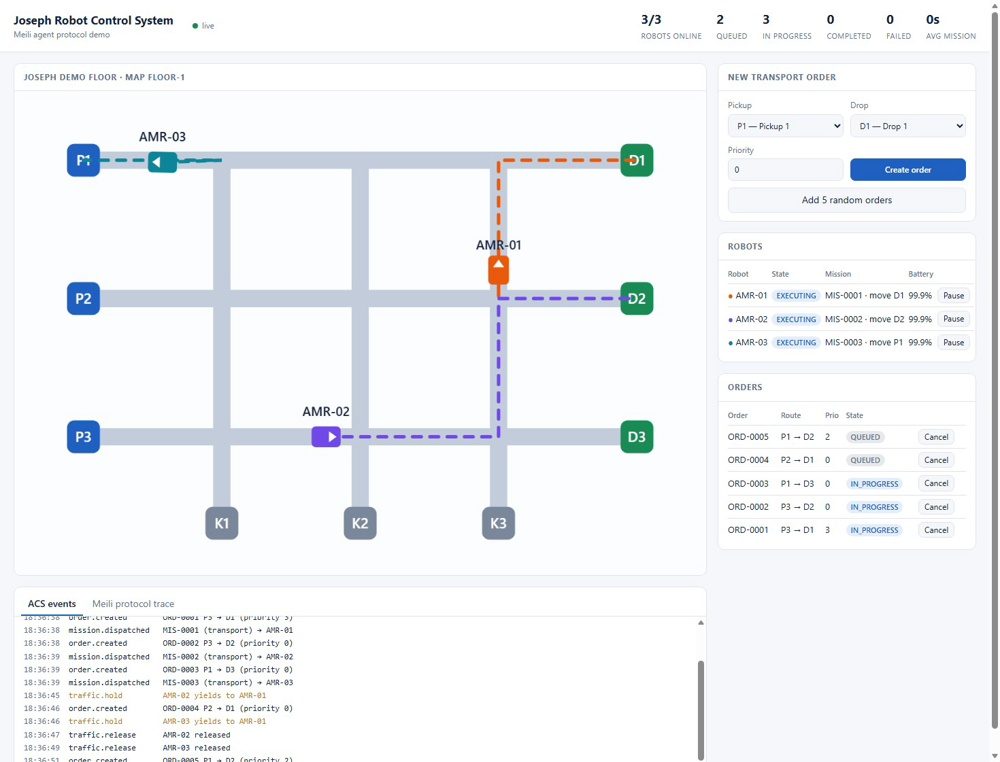
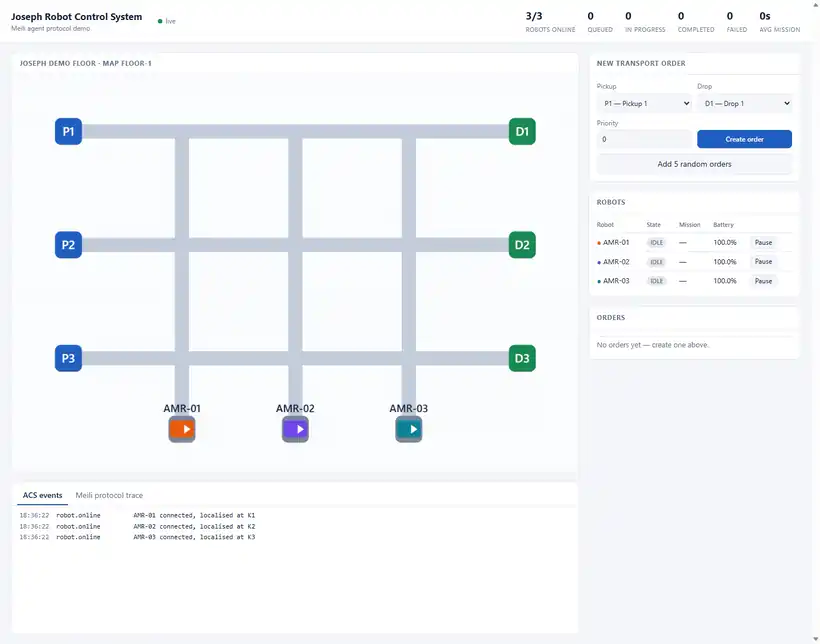

# Joseph Robot Control System × Meili agent demo

Joseph Robot Control System is a small ACS (AMR control system) control plane that **Meili Robots' open-source robot software connects to as if it
were Meili FMS**. Meili's `python-simulator` runs unmodified in a container, talks to the ACS
through the `meili-sdk` WebSocket protocol, and the ACS dispatches transport orders to it.

No Meili account, PIN or cloud access is needed: the ACS implements the FMS side of the protocol.



Forty seconds of the dashboard while Meili's simulator works through five orders
([full-quality MP4](docs/demo.mp4)):



```
 Browser dashboard ──HTTP/SSE──┐
                               ▼
                    ┌──────────────────────┐        ws://…/ws/fleets/        ┌──────────────────────────┐
                    │ acs-core (Node.js)   │ ◄──── Meili agent protocol ───► │ meili-sim (Python)       │
                    │ orders · dispatcher  │   taskv2 / cancelOrder / …      │ Meili python-simulator   │
                    │ traffic · recovery   │   state / goalStatus / …        │ + meili-sdk (MIT)        │
                    └──────────────────────┘                                 └──────────────────────────┘
```

## Run it

```bash
docker compose up --build        # then open http://localhost:8900
```

Create an order in the dashboard (or "Add 5 random orders") and watch the three simulated AMRs
pick up and deliver. The **Meili protocol trace** tab shows every frame exchanged with the agents.

Things to try:

| Action | What it shows |
| --- | --- |
| Create orders with different priorities | Dispatcher: priority queue, nearest eligible robot |
| Send two orders from the same pickup | Traffic hold/release (`slow_down` / `clear_collision`) |
| Pause / resume a robot | Operator inhibit (`startPause` / `stopPause`) |
| Cancel an in-progress order | `cancelOrder`, robot freed for the next order |
| `docker compose stop meili-sim`, wait, `start` | Robots go offline, missions fail, orders are re-queued and finished after reconnect |

Without Docker (Node 20+ only), a Node stand-in for the simulator is included:

```bash
cd acs-core
npm install
npm start              # terminal 1 — ACS on http://localhost:8900
npm run fake-fleet     # terminal 2 — three fake agents speaking the same protocol
npm test               # 9 end-to-end tests against the fake agents
```

If the image build fails with `certificate verify failed`, see [extra-ca/README.md](extra-ca/README.md).

## What comes from Meili

| Piece | Source | Licence | How it is used |
| --- | --- | --- | --- |
| `meili-sdk` | [PyPI](https://pypi.org/project/meili-sdk/) | MIT | Installed inside `meili-sim`; defines the wire protocol |
| `python-simulator` | [gitlab.com/meilirobots/public](https://gitlab.com/meilirobots/public/python-simulator) | **no licence file** | Cloned at a pinned commit when the image is built; not copied into this repo |
| `meili-agent-ros2` | [gitlab.com/meilirobots/public/ros2](https://gitlab.com/meilirobots/public/ros2/meili-agent-ros2) | **no licence file** | Not used here; it uses the same SDK, so it should connect the same way (untested) |

The public Meili repositories carry no licence file, so treat them as "source available": fine to
run as a test tool, but ask Meili before copying their code into a product. Everything under
`acs-core/` is original code written against the MIT-licensed SDK's message formats.
Meili FMS itself (the server) is not open source; this demo does not use or call it.

## How it maps to a vendor-neutral ACS architecture

| Architecture box | In this demo |
| --- | --- |
| Order & Mission | `acs-core/src/core/acs.js` — order → mission → steps (`move`, `pick`, `move`, `drop`) |
| Fleet Dispatcher | `Acs.dispatch()` — eligibility (online, idle, battery), priority, nearest robot, auto-park |
| Traffic & Resources | `core/routing.js` (Dijkstra over stations/paths), `core/traffic.js` (proximity hold) |
| Recovery Manager | `Acs.recover()` / `superviseMission()` — ack timeout, stall watchdog, retry, re-queue, offline |
| Telemetry & Events | `Acs.record()` → dashboard feed + `acs-core/data/events.jsonl` audit log |
| Agent Protocol / Vendor Adapters | `adapters/robot-adapter.js` (the contract) and `adapters/meili/gateway.js` (one implementation) |
| Mock Fleet Lab | `fleet-sim/` (Meili simulator) and `acs-core/tools/fake-agent.js` |
| ACS Portal | `acs-core/public/index.html` (single-file stand-in for the Next.js portal) |

**What is worth carrying into a production ACS**

1. **The adapter boundary.** The core only knows `sendStep / cancelStep / inhibit / setPose` and
   `connected / telemetry / stepStatus` events. A VDA 5050 or ROS 2 adapter would be a second
   subclass of `RobotAdapter`; nothing in `core/` changes.
2. **Meili's protocol as a reference for your own Agent Protocol.** It is small and proven:
   one registration frame, periodic state, goal status by id, and a handful of commands.
   See [docs/meili-agent-protocol.md](docs/meili-agent-protocol.md).
3. **Meili's simulator as a free multi-robot test fleet** for your dispatcher and recovery logic,
   including its differential-drive model (`MOVEMENT_MODEL: "advanced"` in
   `fleet-sim/vehicles_config.json`).

## Limits of the demo

- State is in memory; restarting `acs-core` forgets orders (the reference design uses PostgreSQL/Redis).
- No authentication on the HTTP API or dashboard; the agent gateway checks only the shared fleet token.
- Traffic control is reactive and distance-based. Robots can pass through each other in the
  simulator; a real ACS should reserve path segments and zones.
- A failed mission re-queues the whole order, even if the load was already picked up.
- On every (re)connect a robot is re-localised at its home station, which suits a simulator, not a real robot.
- Only the WebSocket transport is implemented; Meili's MQTT transport and its VDA 5050 mode are not.
- Map sync, docking, topic streaming and multi-floor messages of the protocol are not implemented.

## Layout

```
acs-core/      Node.js ACS: config/, src/core, src/adapters, public/ dashboard, tools/, test/
fleet-sim/     Dockerfile + entrypoint that run Meili's python-simulator against the ACS
docs/          Protocol notes
extra-ca/      Optional build-time root CAs for networks with HTTPS inspection
```

Fleet and site are plain JSON: `acs-core/config/fleet.json` (token, vehicles, home stations) and
`acs-core/config/site.json` (stations and paths, metres).
